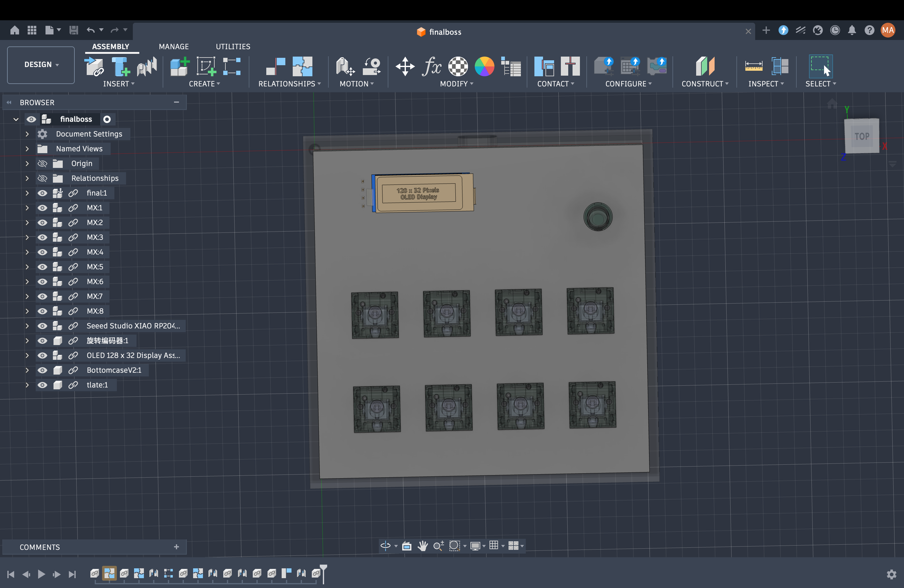
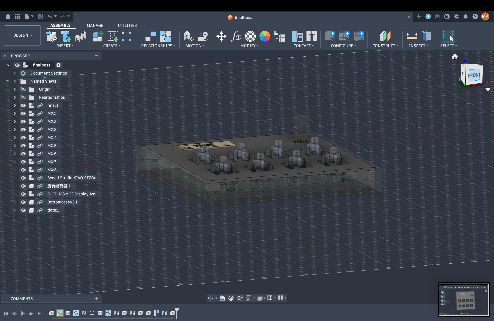
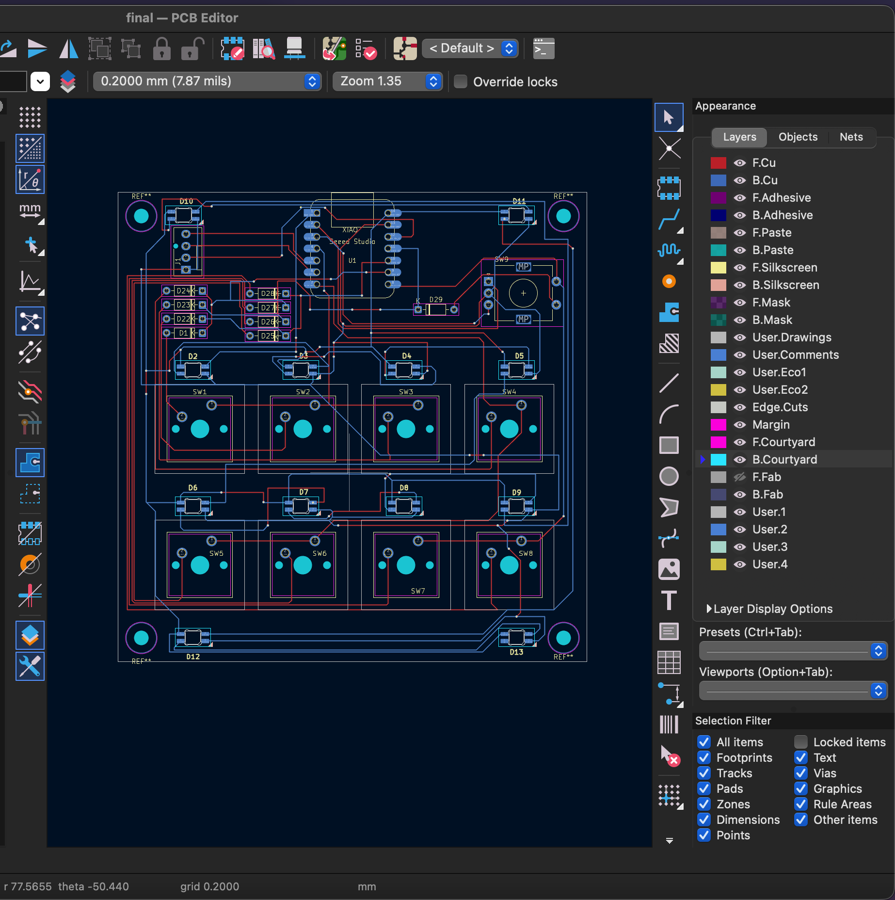
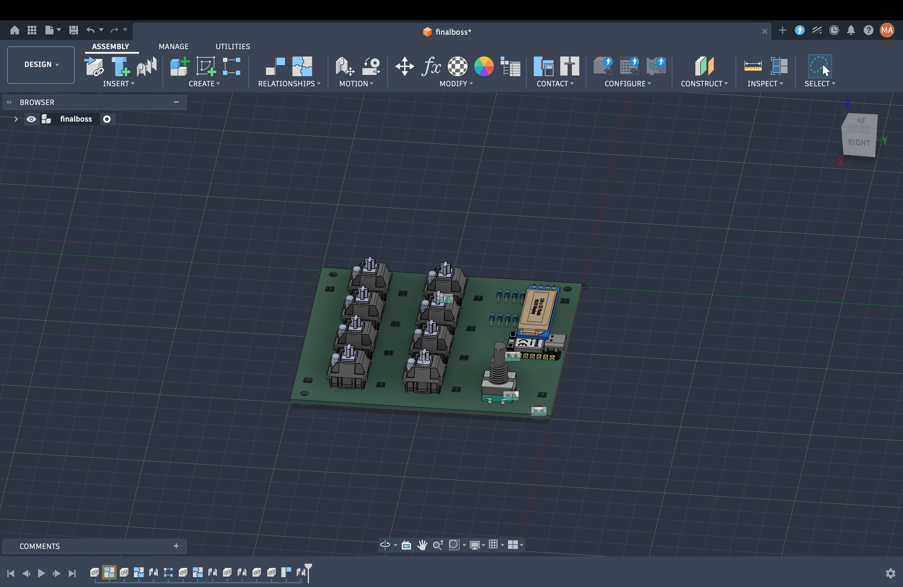
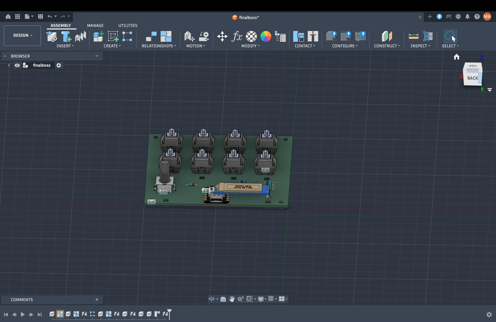
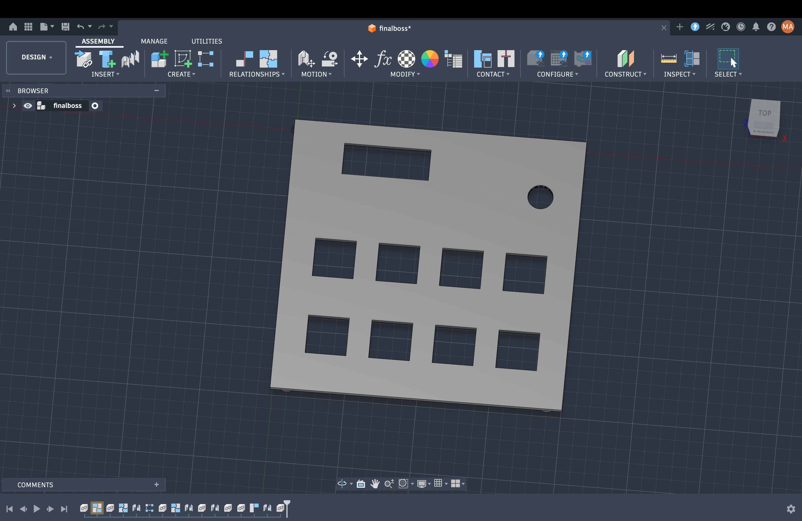
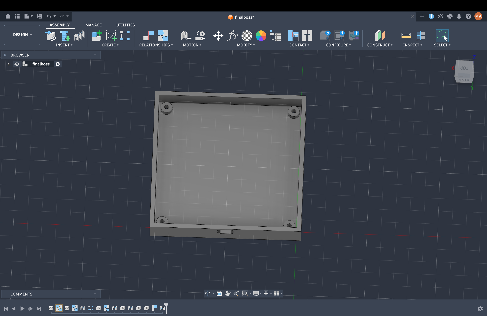

# My Custom Hackpad

**Description:** This is a custom 4x2 macropad powered by a Seeed Studio XIAO RP2040. It features a rotary encoder, a 0.91" OLED display, per-key RGB backlighting, and underglow, all wrapped in a custom 3D-printed snap-fit case.

## 📸 Overall Design

## ⚡ KiCAD Schematic & PCB Layout

## 🛠️ Case Assembly & Fit

## 📋 Bill of Materials (BOM)
* 1x Seeed Studio XIAO RP2040
* 8x Mechanical Key Switches (e.g., Gateron)
* 1x 0.91" I2C OLED Display (4-pin)
* 1x Alps Rotary Encoder
* 8x SK6812MINI-E RGB LEDs (Per-key backlight)
* 4x RGB LEDs (Underglow)
* 9x 1N4148 Diodes
* 1x 3D Printed Top Plate
* 1x 3D Printed Bottom Case

## 📐 Hardware Specifications & Layout Map

| Component Category | Designation | Description / Model | X Position (mm) | Y Position (mm) |
| :--- | :--- | :--- | :--- | :--- |
| **Microcontroller** | `U1` | Seeed Studio XIAO | 50.0 | 12.0 |
| **Display Header** | `J1` | 4-Pin OLED (`GND-VCC-SCL-SDA`) | 14.5 | 16.5 |
| **Rotary Encoder** | `SW9` | Alps Rotary Encoder | 79.0 | 19.0 |
| **Key Switch** | `SW1` | Mechanical Key Switch (R1, C1) | 20.0 | 45.35 |
| **Key Switch** | `SW2` | Mechanical Key Switch (R1, C2) | 42.0 | 45.35 |
| **Key Switch** | `SW3` | Mechanical Key Switch (R1, C3) | 64.0 | 45.35 |
| **Key Switch** | `SW4` | Mechanical Key Switch (R1, C4) | 86.0 | 45.35 |
| **Key Switch** | `SW5` | Mechanical Key Switch (R2, C1) | 20.0 | 74.35 |
| **Key Switch** | `SW6` | Mechanical Key Switch (R2, C2) | 42.0 | 74.35 |
| **Key Switch** | `SW7` | Mechanical Key Switch (R2, C3) | 64.0 | 74.35 |
| **Key Switch** | `SW8` | Mechanical Key Switch (R2, C4) | 86.0 | 74.35 |
| **Backlight LED** | `D2` | SK6812MINI-E (SW1) | 16.0 | 38.0 |
| **Backlight LED** | `D3` | SK6812MINI-E (SW2) | 39.0 | 38.0 |
| **Backlight LED** | `D4` | SK6812MINI-E (SW3) | 61.0 | 38.0 |
| **Backlight LED** | `D5` | SK6812MINI-E (SW4) | 85.0 | 38.0 |
| **Backlight LED** | `D6` | SK6812MINI-E (SW5) | 16.0 | 67.0 |
| **Backlight LED** | `D7` | SK6812MINI-E (SW6) | 39.0 | 67.0 |
| **Backlight LED** | `D8` | SK6812MINI-E (SW7) | 61.0 | 67.0 |
| **Backlight LED** | `D9` | SK6812MINI-E (SW8) | 85.0 | 67.0 |
| **Underglow LED** | `D1` | Underglow LED 1 | 14.0 | 5.0 |
| **Underglow LED** | `D10` | Underglow LED 2 | 85.0 | 5.0 |
| **Underglow LED** | `D11` | Underglow LED 3 | 16.0 | 5.0 |
| **Underglow LED** | `D12` | Underglow LED 4 | 85.0 | 95.0 |
| **Matrix Diode** | `Diode 1` | 1N4148 Diode 1 | 18.0 | 21.0 |
| **Matrix Diode** | `Diode 2` | 1N4148 Diode 2 | 18.0 | 24.0 |
| **Matrix Diode** | `Diode 3` | 1N4148 Diode 3 | 18.0 | 27.0 |
| **Matrix Diode** | `Diode 4` | 1N4148 Diode 4 | 18.0 | 30.0 |
| **Matrix Diode** | `Diode 5` | 1N4148 Diode 5 | 35.8 | 21.6 |
| **Matrix Diode** | `Diode 6` | 1N4148 Diode 6 | 35.8 | 24.6 |
| **Matrix Diode** | `Diode 7` | 1N4148 Diode 7 | 35.8 | 27.6 |
| **Matrix Diode** | `Diode 8` | 1N4148 Diode 8 | 35.8 | 30.6 |
| **Matrix Diode** | `Diode 9` | 1N4148 Diode 9 | 64.0 | 25.0 |
| **Mounting Hole** | `H1` | Top-Left Mounting Hole | 5.0 | 5.0 |
| **Mounting Hole** | `H2` | Top-Right Mounting Hole | 95.0 | 5.0 |
| **Mounting Hole** | `H3` | Bottom-Left Mounting Hole | 5.0 | 95.0 |
| **Mounting Hole** | `H4` | Bottom-Right Mounting Hole | 95.0 | 95.0 |